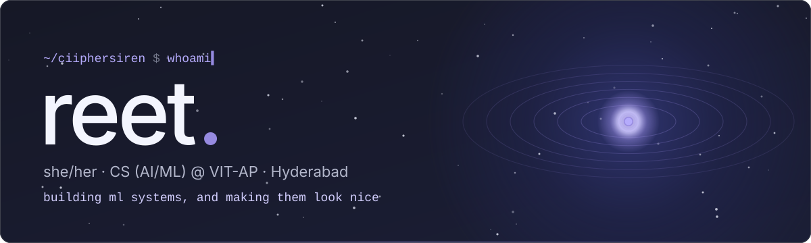
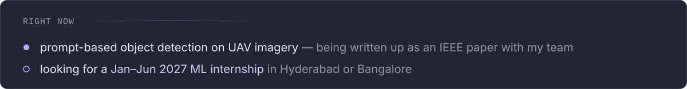

<!--
  ciiphersiren/README.md  ·  reet's github portfolio
  graphics live in ./assets — keep this file and that folder together
-->

## `whoami`

> final-year CS (AI/ML) undergrad who likes knowing *why* a model works, not just that it does.
> lately: small-object detection on drone footage, recommender systems built from scratch, and ML on messy real-world signal data.
> i also make interactive visualizations and graphic art, mostly when i should be doing something else.

## `./projects --featured`

<table>
<tr>
<td width="50%" valign="top">

### 🪐 [reet.](https://github.com/ciiphersiren/ciiphersiren.github.io)
**A portfolio you explore as a solar system**

Six planets, one per section, each on its own orbit. Click a planet and it shatters into particles that fall under gravity, then gather into the section that opens. There's a typed-out boot sequence, a starfield with parallax, and full keyboard navigation. Plain HTML, CSS and JS on `<canvas>`, no frameworks.

Also, something's hiding in a corner.

   

→ **[enter the system](https://ciiphersiren.github.io)**

</td>
<td width="50%" valign="top">

### 🔤 [matlab-ascii-art](https://github.com/ciiphersiren/matlab-ascii-art)
**Image → ASCII art in base MATLAB**

Grayscale or color output, export to text, PNG or HTML, and an interactive app. No toolboxes: I reimplemented resizing, grayscale, histogram equalization and sharpening myself. The block averaging is vectorized with cumulative sums and benchmarked against a loop, including where the speedup disappears once the work becomes memory-bound.

  

   

→ **[File Exchange](https://in.mathworks.com/matlabcentral/fileexchange/185076-ascii-art-generator)** · **[open in MATLAB Online](https://matlab.mathworks.com/open/github/v1?repo=ciiphersiren/matlab-ascii-art)**

</td>
</tr>
<tr>
<td width="50%" valign="top">

### 🎬 [Recomme To Me](https://github.com/ciiphersiren/recomme-to-me)
**Comparing recommender algorithms, built from the ground up**

Popularity, item-based CF, content-based (TF-IDF), matrix factorization, and a hybrid, all evaluated side by side on MovieLens 100k. SVD is hand-written with gradient descent in numpy. Flask backend, plus a dashboard that shows how each model is doing.

    

</td>
<td width="50%" valign="top">

### 🎮 [learn-to-RL](https://github.com/ciiphersiren/learn-to-RL)
**Interactive RL playground**

A browser sandbox where you can *watch* RL agents learn in real time. Grid world, live reward graphs, the whole deal.

   

> *"ouch, that was a wall"* — the agent, episode 16

</td>
</tr>
</table>

### 🔬 research in progress
*code isn't public yet*

**🧠 Chasing Gamma** · *Neuromatch Academy 2026*
Decoding task difficulty from intracranial brain recordings (ECoG). I was the primary coder in a 3-person team: the preprocessing pipeline in MNE, per-channel and region-level stats with FDR correction, spectral parameterization, and a multiclass classifier. The first result was null, and I traced it to a normalization bug: the baseline window overlapped the signal we were measuring. After fixing it, the effect held in 2 of 3 subjects, and the classifier beat chance for all 3 (permutation p < .001).

**🛰️ Prompt-based detection on drone imagery**
We detect small objects in UAV images with YOLO26 and SAHI sliced inference, save the detections, and answer prompts over them ("how many cars?"). YOLOE handles open-vocabulary prompts in the web app. The IEEE conference paper is in progress with my team.

<b>more stuff</b>

 

- 🎭 **[CineMood](https://github.com/ciiphersiren/cinemood)** — mood-based movie recommender with an NLP sentiment pipeline (the one that came before Recomme To Me)
- 🎨 **[design-lab](https://github.com/ciiphersiren/design-lab)** — illustrations and type experiments → [view gallery](https://ciiphersiren.github.io/design-lab)
- 🌐 **[web-dev-learning](https://github.com/ciiphersiren/web-dev-learning)** — dice games, drum kits, a Google clone: the messy, honest record of learning web dev

## `./skills --stack`

## `./etc`

- 🧪 Neuromatch Academy, Computational Neuroscience 2026
- 🏅 NPTEL Elite + Gold, Human–Computer Interaction
- 🧑‍💻 ex-Vice President, President, and Design Lead positions at various clubs
- 🏎️ learning languages, films and creative writing, sketching
- 🦄 INFP if that means anything to you

